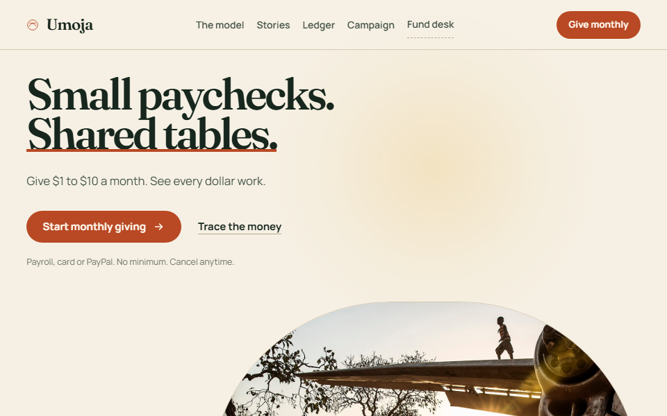

# Umoja

**A donor site for a pan-African NGO: $1 to $10 monthly giving, a public ledger, and an operations desk.**

[Live demo](https://african-fund-022120889256919645090.vercel.app) | HTML, CSS and JavaScript, no build step



Umoja turns small recurring gifts into $10 food vouchers at African-owned groceries, and shows the
money moving while it does it. The site has a donor side, a testimonial side and a working Fund desk
for the people running the campaign.

## What it does

- **Monthly giving from $1 to $10.** Three payment shapes with the fee difference explained: SoFi
  payroll giving, Stripe card, and PayPal.
- **A three-step confirmation.** Amount, payment method, then a preview of the thank-you email and
  text that would go out.
- **A public ledger.** Money in, voucher batches, operating costs, payment fees and the reserve, with
  category filters and a CSV export.
- **Stories and storekeepers.** Sample family and shop slots laid out the way the client described
  them, so the editorial shape is reviewable before any photography exists.
- **A campaign kit.** Copy-ready social posts and a queue for the week's campaign.
- **The Fund desk.** Voucher batches, donor care, and the campaign queue in one operator view.

## Run it locally

```bash
node dev-server.mjs
```

Open <http://127.0.0.1:4173>. Nothing to install. Use a different port with
`$env:PORT=4321; node dev-server.mjs` on Windows, or `PORT=4321 node dev-server.mjs` on macOS and Linux.

## Verify

```bash
node scripts/verify.mjs
```

Checks required markup, duplicate ids, image alt text and dimensions, local assets, CSS tokens,
JavaScript parsing, and live HTTP responses for the page, stylesheet, script and hero image. It also
confirms unknown routes return 404.

## How it is built

| Path | Purpose |
|---|---|
| `index.html` | Donor site: three-step giving flow, stories, public ledger, campaign kit, Fund desk |
| `styles.css` | The visual system: cream paper, forest bands, clay accent, editorial type |
| `app.js` | Amount math, dialog flow, demo gift capture, localStorage ledger, filters, CSV, campaign queue |
| `assets/photos/` | Local documentary photographs, credited in the footer |
| `scripts/verify.mjs` | Structural and route verification |
| `dev-server.mjs` | Zero-dependency local preview server |

The deployment is a static Vercel app, so the files at the root are the whole site.

## What is simulated

Every number is sample data. Payments, payroll connections, vouchers and message delivery are
simulated, and nothing is charged. The ledger persists in `localStorage`; "Reset demo data" in the
Fund desk returns the seeded November state.

## About this prototype

Built as a working prototype for a real brief, then published as part of a portfolio. It is a
bounded demonstration of the product and the flow, not a production system. Before launch it would
need charitable registrations, partner-store agreements, consent for family stories, and real
payment and messaging integrations.
